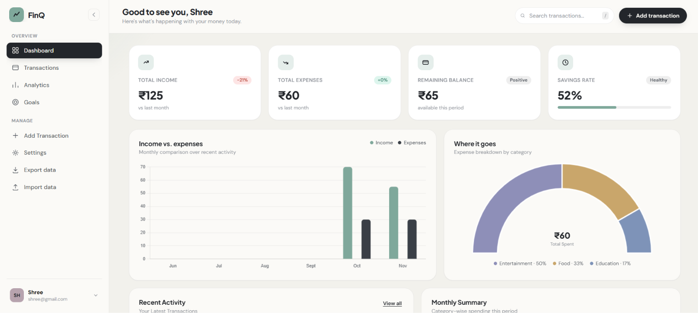
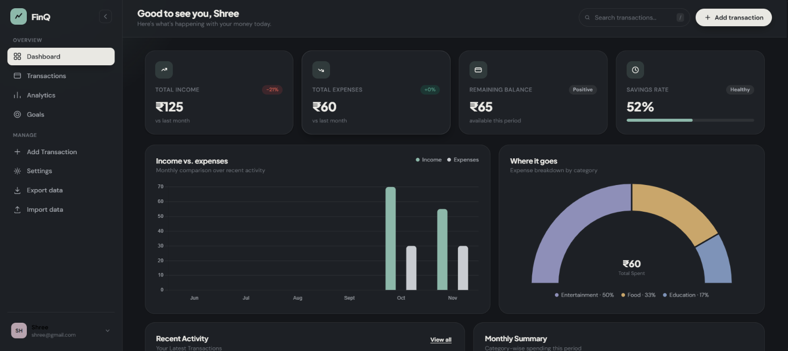
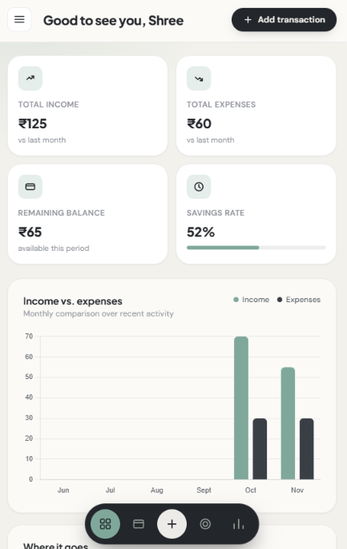
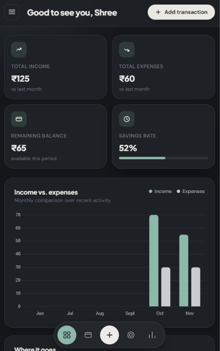

FinQ — Personal Finance Dashboard

A clean, responsive dashboard to track income, expenses and savings goals. Built with HTML, CSS and vanilla JavaScript (no framework) and Chart.js.

## Screenshots

### Desktop
 

### Mobile
 

Features
Add, search, filter, sort and delete income/expense transactions
Dashboard with income vs. expenses chart, spending gauge, recent activity and monthly category summary
My Goals: create savings goals, add funds, track progress
Analytics page with category breakdown and monthly cash-flow trend
Multiple local profiles (switch, add, log out), each with its own data
Export transactions to CSV (opens in Excel/Sheets); import CSV or JSON
Light / Dark / System theme (Settings → Appearance)
Responsive: sidebar on desktop, floating bottom navigation on mobile
Keyboard shortcuts: / search, N new transaction, Esc close
Tech stack

HTML5 · CSS3 (custom properties, grid, flexbox) · JavaScript (ES6+) · Chart.js · localStorage

Run locally

No build step. Open index.html in a browser (or use the VS Code Live Server extension). An internet connection is needed for Google Fonts and Chart.js (loaded from a CDN).

Project structure
index.html
css/style.css
js/script.js
Data & privacy

All data stays in your browser's localStorage; there is no backend. Profiles are a local convenience for separating data, not real authentication — anyone using the same browser can switch to any profile. Clearing site data removes everything, so use Export CSV to back up.

Known limitations
Profiles cannot be deleted yet
Adding funds to a goal does not create a transaction
Importing the same file twice creates duplicate transactions
Ideas for next steps

Edit transactions, budgets per category, recurring transactions, backend with real authentication.

License

MIT
